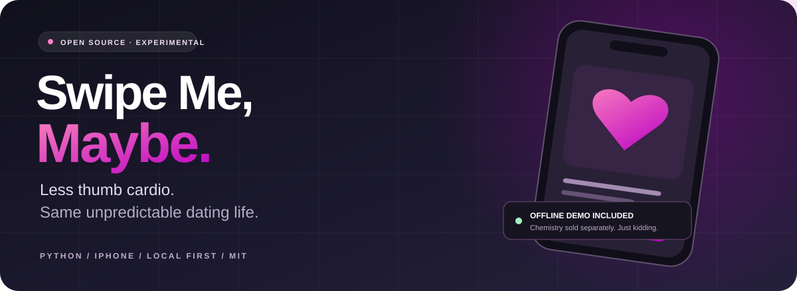
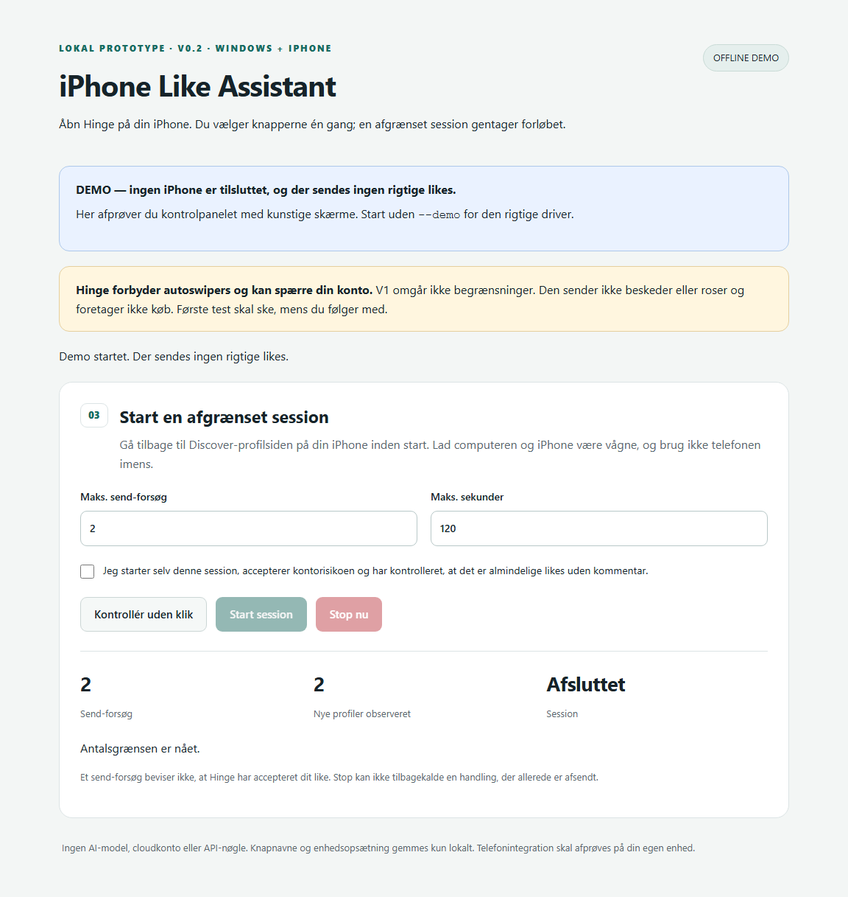
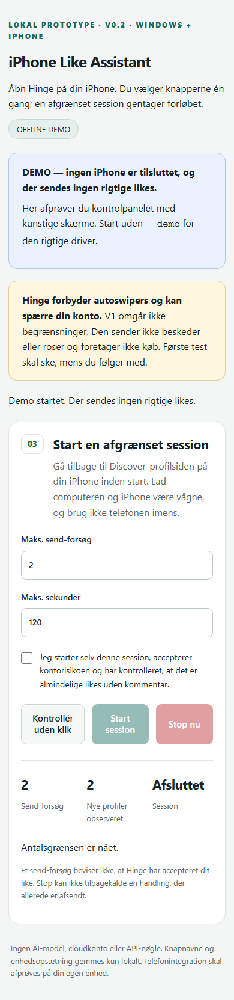
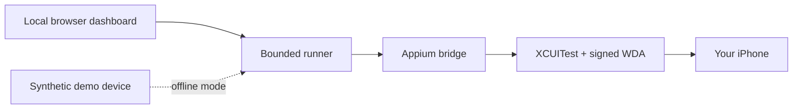

<p align="center">
  
</p>
<p align="center">
  <strong>A local iPhone automation experiment for overworked thumbs.</strong><br>
  Python 3.11+ · Windows + iPhone · Offline demo · <a href="LICENSE">MIT</a>
</p>
<p align="center">
  <a href="#try-the-demo">Try the demo</a> ·
  <a href="docs/HANDOFF.md">Matti, start here</a> ·
  <a href="docs/ROADMAP.md">What's unfinished</a> ·
  <a href="CONTRIBUTING.md">Contribute</a>
</p>

## The pitch

Two friends. One exhausted thumb. An unreasonable amount of optimism.

**Swipe Me, Maybe** started with a modest question: could a small, inspectable
program handle some repetitive taps while we focus on the difficult part —
being interesting enough to get a reply?

It can automate a **bounded ordinary-like flow** through a local dashboard,
Appium and manually calibrated iPhone accessibility controls. It does not
rank people, write messages or manufacture chemistry.

> The code has tests. Our flirting remains an experimental feature.

**Current reality:** the offline demo and synthetic tests work. A complete
session in the actual Hinge app has **not** been verified. Signed WebDriverAgent,
a working device tunnel and real-device calibration are still required.
This is an experimental handoff, not a one-click Hinge product.

## Try the demo

You only need **Python 3.11+**. No phone, Apple account, npm packages or API key.

```powershell
# Windows, from the project folder
py -3 app.py --demo
```

```bash
# macOS / Linux
python3 app.py --demo
```

Or double-click [`demo-windows.cmd`](demo-windows.cmd) on Windows.
Open the local address printed in the terminal, choose **Kontrollér uden klik**
(preview), then try one synthetic attempt. **Stop nu** stops a running demo.
Close the terminal with Ctrl+C when finished.

The dashboard is currently in Danish. An English UI is a welcome contribution.

<details>
<summary><strong>See the dashboard — synthetic demo data only</strong></summary>



<p align="center">
  
</p>

These are generated from the offline fixture. They are not phone screenshots
and do not demonstrate real Hinge compatibility.

</details>

## What is implemented?

| Capability | State |
| --- | --- |
| Local dashboard, offline demo, preview and stop | Implemented and tested |
| Count/time limits and conservative stop conditions | Implemented and tested |
| Manual calibration using observed button names | Tested with synthetic screens |
| Appium/XCUITest bridge and Windows prerequisite doctor | Implemented; software setup tested |
| Unsigned public WDA-to-IPA preparation | Implemented and tested |
| Signed WDA installation, tunnel and actual Hinge flow | **Open — contributors needed** |

Default session: **5 attempts / 120 seconds**. Hard limits: **25 / 600**.
An attempted send and an observed next profile are separate counters; neither
is proof that Hinge accepted a like. A stop cannot recall a request already sent.

## Connect a real iPhone

This part is more involved than plugging in a USB cable:

1. Prepare the phone, Apple drivers and project-local Appium: [Windows guide](docs/WINDOWS.md).
2. Sign and install WebDriverAgent: [Windows signing](docs/WINDOWS-SIGNING.md) or [Mac/Xcode setup](docs/MAC-SETUP.md).
3. Start the RemoteXPC tunnel, Appium and dashboard; connect and calibrate locally.
4. Begin with preview, then one explicitly started, supervised ordinary-like attempt.

Windows requires **iOS 18+**, trusted USB pairing, Developer Mode,
**signed preinstalled WebDriverAgent** and a working RemoteXPC tunnel.
The prepared IPA is unsigned: packaging does not grant permission to run it.
See [Appium's non-macOS guide](https://appium.github.io/appium-xcuitest-driver/latest/guides/non-macos-hosts/).

**Account risk:** Hinge prohibits automated tools and states that use or
distribution can lead to bans. Read [Hinge's own policy](https://help.hinge.co/hc/en-us/articles/49657802257683-Note-on-Third-Party-Automated-Tools)
before deciding whether to use this experiment. This project is independent
and is not affiliated with or endorsed by Hinge.

## How it works



The core accepts exact, locally observed controls. Unknown layouts, alerts,
comment drafts, app changes, failed requests and ambiguous sends stop the run.
There are no blind coordinate clicks and no automatic retry of an uncertain send.

| File | Responsibility |
| --- | --- |
| [`core.py`](core.py) | Screen recognition, bounded runner and stop conditions |
| [`bridge.py`](bridge.py) | Loopback Appium/W3C transport and iPhone configuration |
| [`app.py`](app.py) | Local HTTP API, calibration and session state |
| [`demo.py`](demo.py) | Synthetic phone for development and tests |
| [`windows_doctor.py`](windows_doctor.py) | Read-only Windows prerequisites and USB check |
| [`prepare_wda.py`](prepare_wda.py) | Package a public unsigned WDA app as an IPA |

## Contribute

**Matti:** the code is yours to explore; start with the [handoff](docs/HANDOFF.md).
Everyone else is welcome too. Fork, pick a small [roadmap item](docs/ROADMAP.md),
and send a pull request. No special repository access is needed to propose changes.

```bash
python -m unittest discover -s tests -v
python -m py_compile app.py core.py bridge.py demo.py windows_doctor.py prepare_wda.py
node --check dashboard.js
```

The tests use synthetic devices. CI never connects to an iPhone or sends likes.
See [CONTRIBUTING.md](CONTRIBUTING.md), [verification evidence](VERIFICATION.md),
the [code of conduct](CODE_OF_CONDUCT.md) and [security reporting](SECURITY.md).

## Privacy and scope

The dashboard and Appium bind to loopback. No cloud, model, telemetry or
Hinge password is required. `.local/` holds private device setup and calibration;
accessibility labels can contain personal information, so keep it off GitHub.

No messages, purchases, roses, profile archives, private Hinge APIs, CAPTCHA
handling, rate-limit bypass or evasion. Please contribute synthetic fixtures,
not real profiles, device logs, certificates or credentials.

## License

[MIT](LICENSE) for this repository's code and original artwork.
External tools keep their own licenses; see [third-party notices](NOTICE.md).

Built for Magnus, Matti and everybody whose thumb has requested annual leave.
